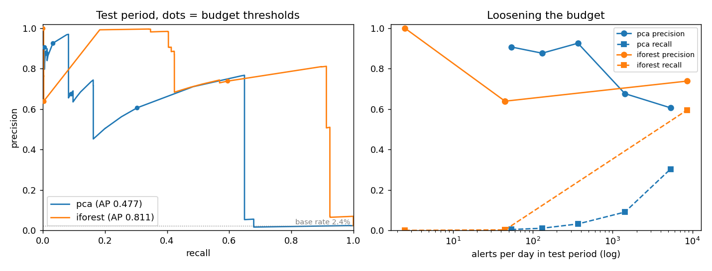
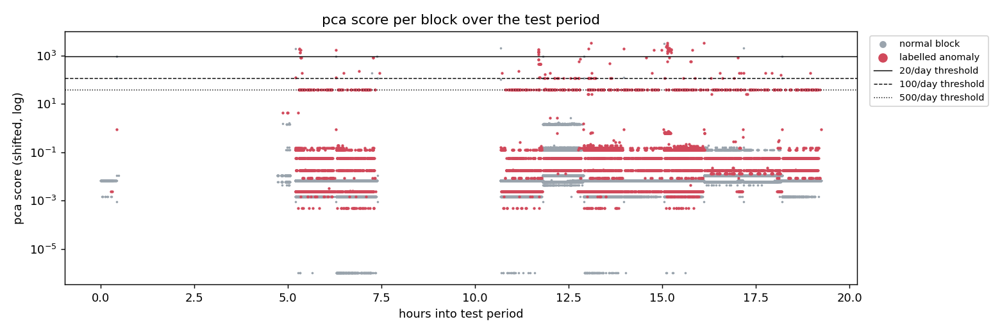

# log-anomaly-detection

Flag anomalous HDFS blocks from raw logs when on-call can only look at about 20 alerts a day.

Two unsupervised detectors, PCA (Xu et al., SOSP 2009) and Isolation Forest, were trained on
the first 19.2 hours of Loghub HDFS_v1 and tested on the next 19.2 hours (362,104 blocks,
8,521 labelled anomalous). Each budget is turned into a score threshold using the training
period only, then applied unchanged to the test period:

| detector | budget | alerts/day in test | precision | recall | average precision |
|---|---|---|---|---|---|
| PCA | 20/day | 54 | 0.907 (39 of 43) | 0.0046 | 0.477 |
| Isolation Forest | 20/day | 2 | 1.000 (2 of 2) | 0.0002 | 0.811 |

**At this budget I would deploy PCA.** It actually spends the budget and nine in ten of
its alerts are real. Isolation Forest ranks blocks better overall (average precision 0.81
against 0.48), but at tight budgets it barely alerts, and how much it alerts depends on the
random seed (see below). An alerting rule whose output changes between 0 and 26 alerts when
you refit it is not something I would put in front of on-call.

Two numbers to read alongside the table. The test period had about 10,600 anomalous blocks
per day, so even a perfect detector at 20 alerts/day finds under 0.2% of them; the budget
only works if each alert stands for a whole incident, not a single block. And PCA fired 54
times a day instead of 20, because the test period carried 1.7 times the block volume of
the training period and the threshold is a score, not a rate.



## Loosening the threshold

Full table in [reports/results.md](reports/results.md).

| budget (set on train) | PCA alerts/day in test | PCA precision | PCA recall | IF alerts/day | IF precision | IF recall |
|---|---|---|---|---|---|---|
| 20 | 54 | 0.907 | 0.005 | 2 | 1.000 | 0.000 |
| 100 | 131 | 0.876 | 0.011 | 45 | 0.639 | 0.003 |
| 500 | 368 | 0.925 | 0.032 | 45 | 0.639 | 0.003 |
| 2,000 | 1,426 | 0.676 | 0.091 | 45 | 0.639 | 0.003 |
| 10,000 | 5,320 | 0.606 | 0.303 | 8,566 | 0.738 | 0.595 |

For PCA, going from 20 to 500 a day costs nothing in precision and multiplies recall by
seven. Past that point precision drops to about two thirds and stays there, and recall never
gets past about 0.65 at any threshold (the left plot): many anomalous blocks score as low as
normal ones. Anomalies are 3.9% of the training blocks, enough for their common patterns to
end up inside the principal subspace that PCA treats as normal behaviour.

Isolation Forest's alert count stays at 45/day from budget 100 to 2,000. The test period has
only 171 distinct event count vectors across 362,104 blocks, identical vectors get identical scores, and one
group of 1,537 tied blocks sits right at those thresholds. Ties are never alerted on (that
would break the budget on the training data), so the threshold can't move until it passes
the whole group. The same lumpiness is why the seed matters:

| seed | AP | 20/day: alerts, precision, recall | 500/day | 10,000/day |
|---|---|---|---|---|
| 0 | 0.811 | 2, 1.00, 0.0002 | 36, 0.64, 0.0027 | 6867, 0.74, 0.5949 |
| 1 | 0.811 | 20, 1.00, 0.0023 | 26, 0.77, 0.0023 | 9401, 0.81, 0.8923 |
| 2 | 0.805 | 26, 0.77, 0.0023 | 54, 0.74, 0.0047 | 6779, 0.73, 0.5846 |
| 3 | 0.812 | 0, -, 0 | 0, -, 0 | 9411, 0.81, 0.8934 |
| 4 | 0.813 | 0, -, 0 | 0, -, 0 | 6868, 0.74, 0.5950 |

(`python -m scripts.iforest_seeds`; counts are over the 19.2 h test period, not per day.)
If the team could take thousands of alerts a day, Isolation Forest would be the better
choice there, but no team can.



## Run it

Needs Python 3.11+ and about 2 GB of disk for the raw log. Parsing takes about 4 minutes
on a laptop CPU; everything after that takes under a minute.

```bash
git clone https://github.com/Alistador/log-anomaly-detection.git
cd log-anomaly-detection
python -m venv .venv && source .venv/bin/activate   # Windows: .venv\Scripts\activate
pip install -r requirements-dev.txt

mkdir -p data/raw && cd data/raw
curl -L -o HDFS_v1.zip "https://zenodo.org/records/8196385/files/HDFS_v1.zip?download=1"
unzip HDFS_v1.zip && mv preprocessed/anomaly_label.csv . && cd ../..

python -m logad.parse      # data/parsed: templates.csv, traces.csv (one row per block)
python -m logad.features   # data/features: count vectors, time-based train/test split
python -m logad.train      # models/: both detectors and their training scores
python -m logad.eval       # reports/: results.md, metrics.json, both plots
pytest -q
```

## How it works

`logad.parse` masks block ids, IPs, paths and numbers in each message and runs Drain over
the masked text. This gives 53 templates, and every one of the 575,061 labelled blocks gets
a trace. Drain's usual similarity threshold of 0.5 merges "PacketResponder N for block X
terminating" (normal) with "... Interrupted." (a failure) once the variables are masked, so
the threshold is 0.9. Lines that mention several blocks are added to each block's trace.

`logad.features` counts events per block and splits by the timestamp of each block's first
line: the first half of the time range trains, the second half tests. Labels are never used
in training.

`logad.eval` turns a budget of B alerts/day into the score that the top B × (training
days) training blocks exceed, and reports what that threshold does on the test period.

## Limitations

The labels come from Loghub, and they were produced by hand-written rules on a benchmark
workload from 2008, so a detector is partly being scored on how well it rediscovers those
rules. The data covers 38.7 hours with long gaps between job batches, so "per day" is an
extrapolation from under a day of test data, and a single time split gives no variance
estimate for PCA. Counting alerts per block overstates the on-call load: anomalous blocks
come in bursts from the same fault, and grouping alerts by template pattern and time window
would matter more in practice than the choice between these two detectors. Event order
inside a block is thrown away; sequence models such as DeepLog use it, but they were out of
scope here. Thresholds are fixed once from the training period; a production version would
recalibrate as block volume changes, which is exactly what went wrong for PCA's 20/day.
